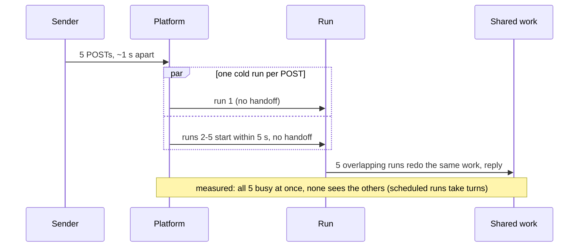
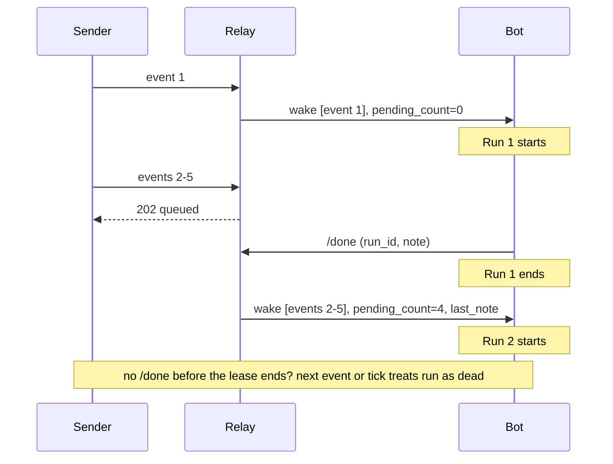
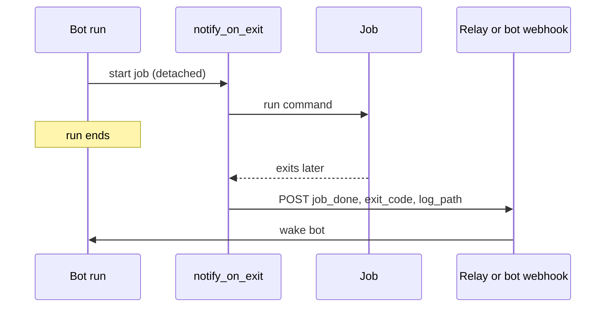

# grokbot-wake-relay

A Grok Bot routine is a saved prompt that runs when a webhook or schedule fires. This repo
is a stopgap for routines woken by webhooks, and a reference for how we'd like wakes to
work natively. It uses only the Python 3.10+ standard library and is MIT licensed.

## 1. The problem

We run a team of webhook-woken bots, and two things keep biting us:

- **Each POST starts its own cold run, and those runs overlap.** We sent 5 POSTs about 1 s
  apart to a test routine. All 5 runs started within 5 s of each other, each busy for about
  60 s, so all 5 were running at once. Nothing hands one run's state to the next (a run
  may see long-term memory, but there is no guaranteed handoff).
  Each repeats the same work, which leads to double replies and stale answers. Scheduled
  runs behave differently: they take turns. A 7-minute run on a 5-minute schedule never
  overlapped; the schedule slot that fell inside the running run was skipped, and the next
  run started at the following slot.
- **Background jobs finish silently.** A job started in a run keeps going after the run
  ends. When it finishes, nobody is told, and the result sits in a log no one reviews.

Today every bot's prompt carries lock, retry and polling rules to paper over both problems.

### Today: burst of webhooks



## 2. What this repo does

**`notify_on_exit.py`** is the more broadly useful piece. It runs a job detached, and when
the job exits it wakes the bot with `{kind: "job_done", job, exit_code, log_path}`. It sends
the exit code and log path, never log contents, and a job killed by SIGTERM reports `143`.
It retries 5xx and network errors with backoff and jitter, and does not retry other 4xx,
with one exception: the platform answers a run-rate-limit rejection with an HTTP `400` whose
body says "rate limit", and that one is temporary, so the wrapper retries it over several
minutes (5 more tries from a 15 s base). It's POSIX only. If the wrapper itself is SIGKILLed,
nothing is sent.

**`relay.py`** is a prototype. Use it if overlapping webhook runs hurt you, or if you want
batching plus a handoff note today. It sits between event senders and the bot's webhook:
- **Idle routine:** the event is forwarded right away.
- **Active routine:** the event is queued, and the relay returns `202`.
- **Run calls `/done`:** the queued events go out as **one** wake that carries
  `pending_count` and the last run's note.

It also has these safeguards:
- a lease timeout un-wedges crashed runs;
- duplicate event ids are dropped;
- forwards retry with backoff and jitter but never follow redirects;
- events stranded by failed forwards are re-sent on the next tick;
- a restart resets the routine to idle and re-sends anything pending;
- a batch is saved before it is forwarded, so a crash mid-forward re-sends it after a restart.
  Delivery is at-least-once: a crash just after the bot accepted a wake can repeat it;
- forwards to the bot retry any failure, including the platform's rate-limit `400`; if the
  retries run out, the events wait and the next tick (every 30 s) tries again.

**Restart during a live run.** The relay can't tell whether a run it was tracking is still
alive, so a restart goes idle. The next event starts a second run, which may overlap the
old one. The old run's `/done` is still accepted once, for its note only, and only when it
carries a note: it gets `200`, its note becomes `last_note` for the next wake unless the new
run's `/done` brings its own note, and the new run is untouched. A noteless orphan `/done`
gets `409`, and so does any later `/done` from the old run.

### With the relay



### Completion wake



## 3. Quick start

Files: `relay.py`, `notify_on_exit.py`, `demo.py` (a localhost-only end-to-end demo),
and `tests/` (run with `python -m unittest discover -s tests`).

```sh
python demo.py
python -m unittest discover -s tests -v

# real use: every secret lives in a file (chmod 600), never inline
export RELAY_DOWNSTREAM_URL_FILE=./bot-webhook.url
export RELAY_DOWNSTREAM_KEY_FILE=./bot-webhook.key
export RELAY_INBOUND_SECRET_FILE=./relay-inbound.secret
python relay.py                           # listens on 127.0.0.1:8787

# wrap a long job; relay-event.url holds http://127.0.0.1:8787/event
NOTIFY_URL_FILE=./relay-event.url NOTIFY_KEY_FILE=./relay-inbound.secret \
  python notify_on_exit.py --job nightly --log ./nightly.log -- ./nightly.sh
```

Event senders POST to the relay's `/event` with `Authorization: Bearer <secret>`.

### The routine's one extra step

Every wake carries four fields:
- `events`;
- `pending_count`: how many events in this batch queued while a run was active;
- `last_note`;
- `run_id`.

The run's last step is:

```
POST /done   {"run_id": "<from the wake>", "note": "what I did / what's next"}
```

The next wake receives `note` as `last_note`. `run_id` is required: a `/done` without one
gets `400`, and one from an old run gets `409`.

### Config (env vars; secrets are file paths, never values)

| Variable | Meaning | Default |
|---|---|---|
| `RELAY_DOWNSTREAM_URL_FILE` | file containing the bot webhook URL | required |
| `RELAY_DOWNSTREAM_KEY_FILE` | file containing the bot webhook bearer key | required |
| `RELAY_INBOUND_SECRET_FILE` | file containing the secret callers must send | off (required for non-loopback bind) |
| `RELAY_STATE` | state file path | `relay-state.json` |
| `RELAY_LEASE_SECONDS` | how long until a run without `/done` is treated as dead | `900` |
| `RELAY_TICK_SECONDS` | how often the lease and stranded events are checked | `30` |
| `RELAY_BIND` / `RELAY_PORT` | listen address (IPv4 or IPv6, e.g. `::1`) | `127.0.0.1` / `8787` |
| `RELAY_RETRIES` / `RELAY_BACKOFF` | forward retries and base delay (s); total must fit in the lease | `5` / `1.0` |
| `NOTIFY_URL_FILE` / `NOTIFY_KEY_FILE` | wrapper target and key | required / off |
| `NOTIFY_BACKOFF` / `NOTIFY_RATE_BACKOFF` | wrapper base delay (s) for errors / for rate-limit `400`s | `1.0` / `15` |

The relay won't start in an unsafe or inconsistent setup:
- It refuses a non-loopback bind (loopback means `127.0.0.0/8`, `localhost` or `::1`) without an inbound secret.
- It rejects request bodies over 64 KB with `413`.
- It won't start if its retry budget is longer than the lease.

URLs and keys are never logged. The state file can hold full event bodies, so keep it
private. It's in `.gitignore`.

### Demo output

```
t= 0.0s POST /event evt-0 -> 200 {'status': 'forwarded'}
t= 0.4s POST /event evt-1 -> 202 {'status': 'queued', 'pending': 1}
t= 0.8s POST /event evt-2 -> 202 {'status': 'queued', 'pending': 2}
t= 1.2s POST /event evt-3 -> 202 {'status': 'queued', 'pending': 3}
t= 1.6s POST /event evt-4 -> 202 {'status': 'queued', 'pending': 4}
run 1 finishes and calls /done -> (200, {'status': 'forwarded batch', 'count': 4})
run 2 finishes and calls /done -> (200, {'status': 'idle'})

fake bot saw 2 forwards (5 events):
  wake 1: events=['evt-0'] pending_count=0 last_note=null
  wake 2: events=['evt-1', 'evt-2', 'evt-3', 'evt-4'] pending_count=4 last_note="handled evt-0"
```

## 4. Reproduce it yourself

About 20 minutes. You need bash, curl and Python 3.10+ on the machine your bot's shell runs on.

**1. Make a throwaway routine.** In Grok Bot, create a routine with a webhook trigger.
Copy its webhook URL and key from the routine's details straight into owner-only files.
Never paste the key into a chat or commit it.

```sh
umask 077; mkdir -p ~/relay-test && cd ~/relay-test
cat > bot-webhook.url      # paste the URL, Enter, Ctrl-D
cat > bot-webhook.key      # paste the key without "Bearer ", Enter, Ctrl-D
python3 -c 'import secrets; print(secrets.token_urlsafe(36))' > inbound.secret
echo http://127.0.0.1:8787/event > relay-event.url
chmod 600 ./*
auth() { printf 'Authorization: Bearer %s\n' "$(cat "$1")"; }  # keeps keys off the command line
```

Give the routine a prompt like this one (swap in your own folder):

> On each wake, append one line to `~/relay-test/live.log`:
> `wake <time> run_id=<run_id> pending_count=<n> events=<ids> last_note=<last_note>`.
> Stay busy for about 60 s. Then POST `{"run_id": "<run_id>", "note": "handled <ids>"}` to
> `http://127.0.0.1:8787/done` with `Authorization: Bearer <contents of ~/relay-test/inbound.secret>`,
> and append `done <time> <status> <response>` to the same log. Never print the secret.
> Send nothing to anyone.

**2. See the problem.** Send a burst straight to the webhook:

```sh
for i in 1 2 3 4 5; do
  curl -s -X POST "$(cat bot-webhook.url)" -H @<(auth bot-webhook.key) \
    -H 'Content-Type: application/json' -d "{\"id\":\"direct-$i\"}"; sleep 1
done
```

You get 5 separate cold runs and 5 `wake` lines, each with no idea the others happened.
They run at the same time. In our test, POSTs at 1 s intervals gave 5 runs that all started
within 5 s and all finished 60-80 s later, so all 5 were busy at once. Their `/done` calls
fail, because no relay is running yet. (A schedule behaves differently: its runs take turns.)

For the silent job, ask the bot in a run to start
`setsid nohup sh -c 'sleep 120; echo finished > ~/relay-test/job.txt' >/dev/null 2>&1 &`
and end its turn (we only showed a `setsid` job outliving the end of its run). `job.txt` appears two minutes later, and nobody is woken.

**3. Apply the fix.** Start the relay, then send the same burst to it instead:

```sh
RELAY_STATE=$PWD/state.json RELAY_DOWNSTREAM_URL_FILE=$PWD/bot-webhook.url \
RELAY_DOWNSTREAM_KEY_FILE=$PWD/bot-webhook.key RELAY_INBOUND_SECRET_FILE=$PWD/inbound.secret \
  nohup python3 /path/to/relay.py > relay.out 2>&1 &
for i in 1 2 3 4 5; do
  curl -s -X POST "$(cat relay-event.url)" -H @<(auth inbound.secret) \
    -H 'Content-Type: application/json' -d "{\"id\":\"evt-$i\"}"; echo; sleep 1
done
```

Expect `forwarded` and then 4 × `queued`. In our run against a live routine, 5 events became
2 wakes. The first wake came 6 s after the first event, with `pending_count=0`. About 70 s
later, run 1's `/done` got `forwarded batch, count 4`. The second wake came 6 s after that,
with `pending_count=4`, all 4 queued ids and run 1's note as `last_note`. Run 2's `/done`
got `idle`. `relay.out` prints one `relay: listening on 127.0.0.1:8787` line at startup,
then only failed forwards, as status codes, never URLs or keys.

For the job, have the bot wrap it instead:

```sh
NOTIFY_URL_FILE=$PWD/relay-event.url NOTIFY_KEY_FILE=$PWD/inbound.secret \
  python3 /path/to/notify_on_exit.py --job demo --log $PWD/job.log -- sleep 60
```

When `sleep` exits, the wrapper posts an event with `kind: job_done`, `exit_code: 0` and the
log path. Through the relay it is one of the wake's `events`: a new wake if the routine is idle,
or queued (`202`) for the next wake if a run is active.

**4. Clean up.** Stop the relay (`pkill -f relay.py`), delete the routine in Grok Bot (this
retires its key), then `rm -rf ~/relay-test`.

## 5. Limits, and what the platform should ship natively

This is a workaround with known limits:
- **It can't reach a live run.** The relay can't push events into a run that's already
  going; it can only batch them for the next run.
- **The routine has to cooperate.** It must call `/done`. If a run crashes, queued events
  wait for the lease to expire.
- **The note is manual.** `last_note` is only as good as what the run writes.
- **The wrapper has gaps.** It's POSIX only, and a SIGKILL sends nothing.
- **A restart can let two runs overlap.** See "Restart during a live run" above.
- **It isn't hardened for the internet.** It's one process per routine, bound to
  localhost by default. Put TLS in front of it if you expose it.

What we'd like the platform to ship instead:

1. **Coalesce webhook events the way schedules already work.** Scheduled runs take turns, but
   webhook runs overlap: 5 POSTs gave 5 runs at once. Never run a routine twice at once;
   deliver new events into the active run or one follow-up run with a pending count.
2. **A small pinned per-routine state.** One run writes it, and the next run starts with it
   loaded. Keep it separate from long-term memory.
3. **A completion wake for jobs the bot started.** Wake the bot with the exit code and output
   path: a new turn if it's idle, or queued into the current turn if it's busy. Waking on
   matched output lines should be opt-in and rate-capped.

Once those ship, this repo can be deleted.
