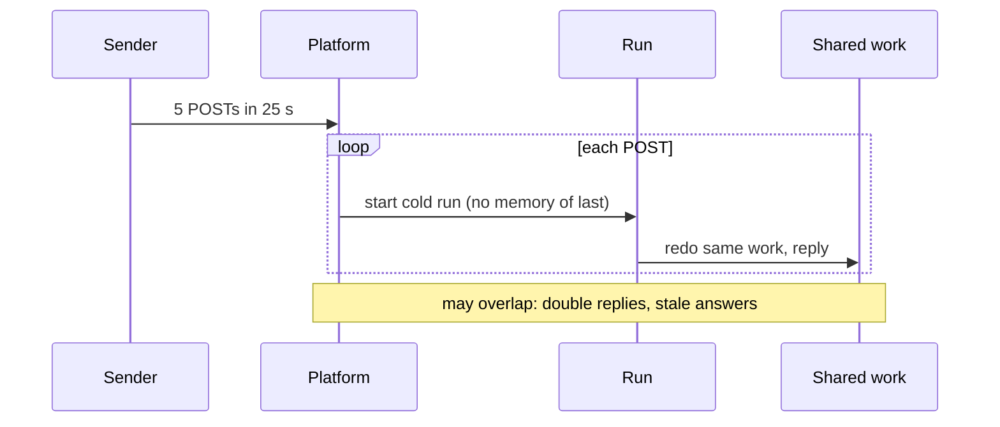
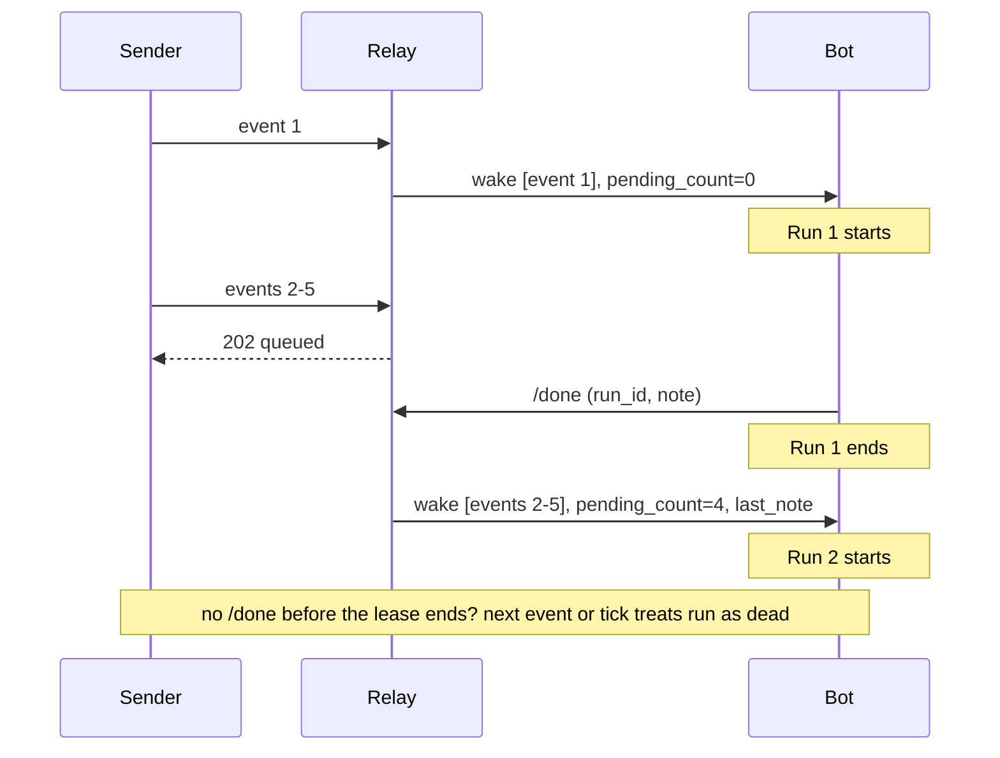
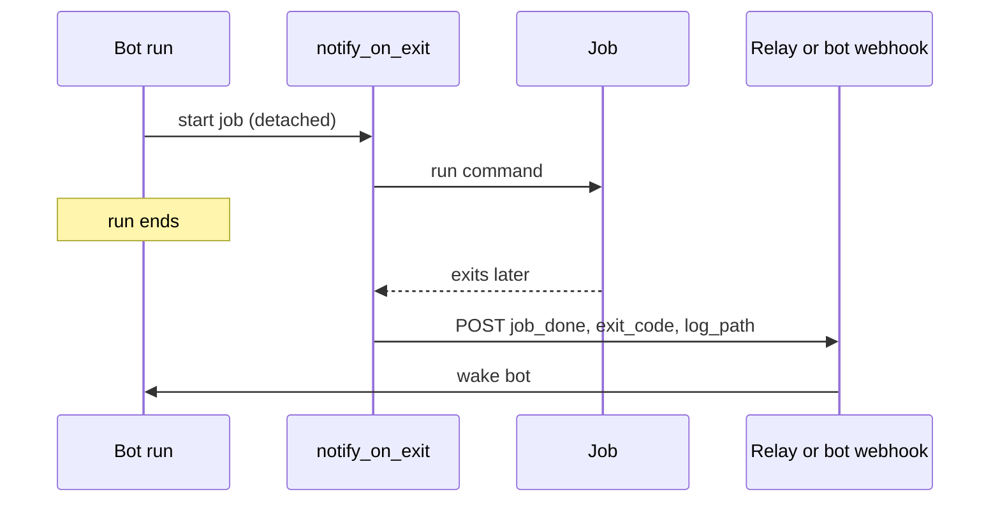

# grokbot-wake-relay

A Grok Bot routine is a saved prompt that runs when a webhook or schedule fires. This repo
is a stopgap for routines woken by webhooks, and a reference for how we'd like wakes to
work natively. It uses only the Python 3.10+ standard library and is MIT licensed.

## 1. The problem

We run a team of webhook-woken bots, and two things keep biting us:

- **Each POST starts its own cold run.** A burst of 5 events in 25 s gives 5 runs. None of
  them knows what the last one did, so each repeats the same work, and that leads to
  double replies and stale answers. Scheduled runs appear serialized: a 7-minute run on
  a 5-minute schedule never overlapped. Whether webhook runs actually overlap is unconfirmed.
- **Background jobs finish silently.** A job started in a run keeps going after the run
  ends. When it finishes, nobody is told, and the result sits in a log no one reviews.

Today every bot's prompt carries lock, retry and polling rules to paper over both problems.

### Today: burst of webhooks



## 2. What this repo does

**`notify_on_exit.py`** is the more broadly useful piece. It runs a job detached, and when
the job exits it wakes the bot with `{kind: "job_done", job, exit_code, log_path}`. It sends
the exit code and log path, never log contents, and a job killed by SIGTERM reports `143`.
It's POSIX only. If the wrapper itself is SIGKILLed, nothing is sent.

**`relay.py`** is a prototype. You only need it if your webhook runs overlap, or if you want
batching plus a handoff note today. It sits between event senders and the bot's webhook:
- **Idle routine:** the event is forwarded right away.
- **Active routine:** the event is queued, and the relay returns `202`.
- **Run calls `/done`:** the queued events go out as **one** wake that carries
  `pending_count` and the last run's note.

It also has these safeguards:
- a lease timeout un-wedges crashed runs;
- duplicate event ids are dropped;
- forwards retry with backoff and jitter but never follow redirects;
- events stranded by failed forwards are re-sent on the next tick;
- a restart resets the routine to idle and re-sends anything pending.

### With the relay



### Completion wake



## 3. Quick start

Files: `relay.py`, `notify_on_exit.py`, `demo.py` (a localhost-only end-to-end demo),
and `tests/` (run with `python -m unittest discover -s tests`).

```sh
python demo.py
python -m unittest discover -s tests -v

# real use: every secret lives in a file (chmod 600), never inline
export RELAY_DOWNSTREAM_URL_FILE=./bot-webhook.url
export RELAY_DOWNSTREAM_KEY_FILE=./bot-webhook.key
export RELAY_INBOUND_SECRET_FILE=./relay-inbound.secret
python relay.py                           # listens on 127.0.0.1:8787

# wrap a long job; relay-event.url holds http://127.0.0.1:8787/event
NOTIFY_URL_FILE=./relay-event.url NOTIFY_KEY_FILE=./relay-inbound.secret \
  python notify_on_exit.py --job nightly --log ./nightly.log -- ./nightly.sh
```

Event senders POST to the relay's `/event` with `Authorization: Bearer <secret>`.

### The routine's one extra step

Every wake carries four fields:
- `events`;
- `pending_count`: how many events in this batch queued while a run was active;
- `last_note`;
- `run_id`.

The run's last step is:

```
POST /done   {"run_id": "<from the wake>", "note": "what I did / what's next"}
```

The next wake receives `note` as `last_note`. `run_id` is required: a `/done` without one
gets `400`, and one from an old run gets `409`.

### Config (env vars; secrets are file paths, never values)

| Variable | Meaning | Default |
|---|---|---|
| `RELAY_DOWNSTREAM_URL_FILE` | file containing the bot webhook URL | required |
| `RELAY_DOWNSTREAM_KEY_FILE` | file containing the bot webhook bearer key | required |
| `RELAY_INBOUND_SECRET_FILE` | file containing the secret callers must send | off (required for non-loopback bind) |
| `RELAY_STATE` | state file path | `relay-state.json` |
| `RELAY_LEASE_SECONDS` | how long until a run without `/done` is treated as dead | `900` |
| `RELAY_TICK_SECONDS` | how often the lease and stranded events are checked | `30` |
| `RELAY_BIND` / `RELAY_PORT` | listen address | `127.0.0.1` / `8787` |
| `RELAY_RETRIES` / `RELAY_BACKOFF` | forward retries and base delay (s); total must fit in the lease | `5` / `1.0` |
| `NOTIFY_URL_FILE` / `NOTIFY_KEY_FILE` | wrapper target and key | required / off |

The relay won't start in an unsafe or inconsistent setup:
- It refuses a non-loopback bind without an inbound secret.
- It rejects request bodies over 64 KB with `413`.
- It won't start if its retry budget is longer than the lease.

URLs and keys are never logged. The state file can hold full event bodies, so keep it
private. It's in `.gitignore`.

### Demo output

```
t= 0.0s POST /event evt-0 -> 200 {'status': 'forwarded'}
t= 0.4s POST /event evt-1 -> 202 {'status': 'queued', 'pending': 1}
t= 0.8s POST /event evt-2 -> 202 {'status': 'queued', 'pending': 2}
t= 1.2s POST /event evt-3 -> 202 {'status': 'queued', 'pending': 3}
t= 1.6s POST /event evt-4 -> 202 {'status': 'queued', 'pending': 4}
run 1 finishes and calls /done -> (200, {'status': 'forwarded batch', 'count': 4})
run 2 finishes and calls /done -> (200, {'status': 'idle'})

fake bot saw 2 forwards (5 events):
  wake 1: events=['evt-0'] pending_count=0 last_note=null
  wake 2: events=['evt-1', 'evt-2', 'evt-3', 'evt-4'] pending_count=4 last_note="handled evt-0"
```

## 4. Limits, and what the platform should ship natively

This is a workaround with known limits:
- **It can't reach a live run.** The relay can't push events into a run that's already
  going; it can only batch them for the next run.
- **The routine has to cooperate.** It must call `/done`. If a run crashes, queued events
  wait for the lease to expire.
- **The note is manual.** `last_note` is only as good as what the run writes.
- **The wrapper has gaps.** It's POSIX only, and a SIGKILL sends nothing.
- **It isn't hardened for the internet.** It's one process per routine, bound to
  localhost by default. Put TLS in front of it if you expose it.

What we'd like the platform to ship instead:

1. **Coalesce webhook events like schedules.** Never run a routine twice at once; deliver
   new events into the active run or one follow-up run with a pending count.
2. **A small pinned per-routine state.** One run writes it, and the next run starts with it
   loaded. Keep it separate from long-term memory.
3. **A completion wake for jobs the bot started.** Wake the bot with the exit code and output
   path: a new turn if it's idle, or queued into the current turn if it's busy. Waking on
   matched output lines should be opt-in and rate-capped.

Once those ship, this repo can be deleted.
