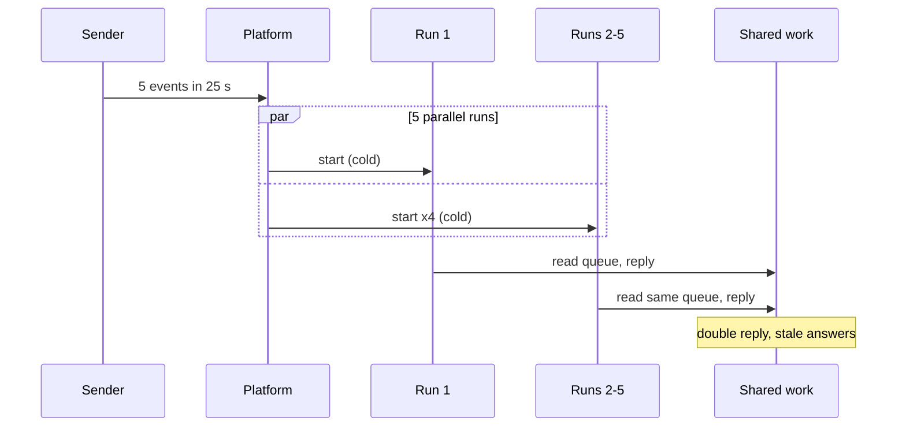
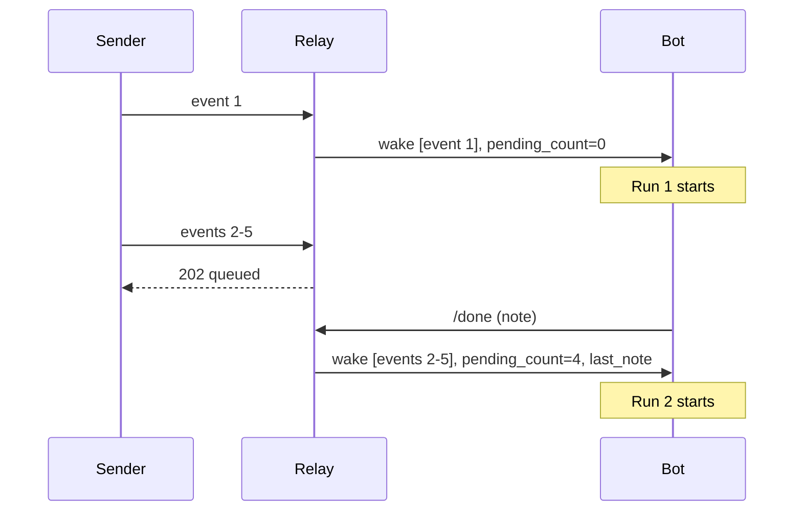
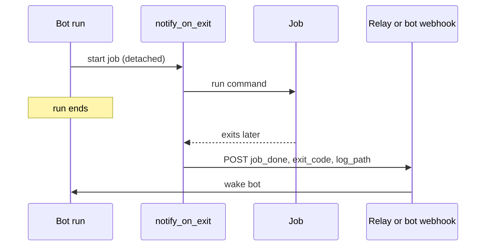

# grokbot-wake-relay

A stopgap for Grok Bot routines woken by webhooks. It's also a reference for how we'd
like wakes to work natively. It uses only the Python 3.10+ standard library and is MIT licensed.

## 1. The problem

We run a team of webhook-woken bots, and two things keep biting us:

- **Bursts of events race.** Every webhook POST starts its own cold run. A burst of
  5 events in 25 s starts 5 runs that race for the same work. That causes double
  replies and stale answers, and no run knows what the last one did.
- **Background jobs finish silently.** A job started in a run keeps going after the run
  ends. When it finishes, nobody is told, and the result sits in a log no one reviews.

Today every bot's prompt carries lock, retry and polling rules to paper over both problems.

### Today: burst of webhooks




## 2. What this repo does

- **`relay.py`** sits between event senders and the bot's webhook:
  - **Idle routine:** the event is forwarded right away.
  - **Active routine:** the event is queued, and the relay returns `202`.
  - **Run calls `/done`:** the queued events go out as **one** wake that carries the
    events, `pending_count` and the last run's note.
  - **Safety rails:**
    - a lease timeout un-wedges runs that crash without calling `/done`;
    - duplicate event ids are dropped;
    - forwards retry with backoff and jitter;
    - state survives restarts.
- **`notify_on_exit.py`** runs a job detached. When the job exits, it wakes the bot with
  `{kind: "job_done", job, exit_code, log_path}`. It sends the exit code and log path,
  never log contents. A job killed by SIGTERM reports `143`.

### With the relay



### Completion wake



## 3. Quick start

```sh
python demo.py                            # localhost-only end-to-end demo
python -m unittest discover -s tests -v   # 16 tests, about 12 s

# real use: secrets live in files (chmod 600), never inline
export RELAY_DOWNSTREAM_URL_FILE=./bot-webhook.url
export RELAY_DOWNSTREAM_KEY_FILE=./bot-webhook.key
export RELAY_INBOUND_SECRET_FILE=./relay-inbound.secret
python relay.py                           # listens on 127.0.0.1:8787

# wrap a long job so the bot hears when it ends
NOTIFY_URL_FILE=./relay-event.url NOTIFY_KEY_FILE=./relay-inbound.secret \
  python notify_on_exit.py --job nightly --log ./nightly.log -- ./nightly.sh
```

Point your event senders at the relay's `/event` and send `Authorization: Bearer <secret>`.

### The routine's one extra step

Every wake includes `events`, `pending_count`, `last_note` and `run_id`. As the run's last step, it calls:

```
POST /done   {"note": "what I did / what's next", "run_id": "<from the wake>"}
```

The next wake receives that note as `last_note`. A `/done` from an old run gets `409`.

### Config (env vars)

| Variable | Meaning | Default |
|---|---|---|
| `RELAY_DOWNSTREAM_URL_FILE` | file containing the bot webhook URL | required |
| `RELAY_DOWNSTREAM_KEY_FILE` | file containing the bot webhook bearer key | required |
| `RELAY_INBOUND_SECRET_FILE` | file containing the secret callers must send | off |
| `RELAY_STATE` | state file path | `relay-state.json` |
| `RELAY_LEASE_SECONDS` | how long until a run without `/done` is treated as dead | `900` |
| `RELAY_TICK_SECONDS` | how often the lease is checked | `30` |
| `RELAY_BIND` / `RELAY_PORT` | listen address | `127.0.0.1` / `8787` |
| `RELAY_RETRIES` / `RELAY_BACKOFF` | forward retries and base delay (s) | `5` / `1.0` |
| `NOTIFY_URL_FILE` / `NOTIFY_KEY_FILE` | wrapper target (relay `/event` or bot webhook) and key | required / off |

URLs and keys are only ever read from files. They're never logged or printed.

### Demo output

```
t= 0.0s POST /event evt-0 -> 200 {'status': 'forwarded'}
t= 0.4s POST /event evt-1 -> 202 {'status': 'queued', 'pending': 1}
t= 0.8s POST /event evt-2 -> 202 {'status': 'queued', 'pending': 2}
t= 1.2s POST /event evt-3 -> 202 {'status': 'queued', 'pending': 3}
t= 1.6s POST /event evt-4 -> 202 {'status': 'queued', 'pending': 4}
run 1 finishes and calls /done -> (200, {'status': 'forwarded batch', 'count': 4})
run 2 finishes and calls /done -> (200, {'status': 'idle'})

fake bot saw 2 forwards (5 events):
  wake 1: events=['evt-0'] pending_count=0 last_note=null
  wake 2: events=['evt-1', 'evt-2', 'evt-3', 'evt-4'] pending_count=4 last_note="handled evt-0"
```

Five events became two wakes instead of five racing runs.

## 4. Limits, and what the platform should ship natively

This is a workaround with known limits:
- **It can't reach a live run.** It can't push events into a run that's already going;
  it can only batch them for the next run.
- **The routine has to cooperate.** It must call `/done`. If a run crashes, queued
  events wait for the lease to expire.
- **The note is manual.** `last_note` is only as good as what the run writes.
- **Hard kills go unreported.** A SIGKILLed job can't report its exit.
- **It isn't hardened for the internet.** It's one process per routine, bound to
  localhost by default. Put TLS and auth in front of it if you expose it.

What we'd like the platform to ship instead:

1. **Coalesce or queue events into the active run.** Deliver new events to the live run,
   or hold them for one follow-up run with a pending count. Never run a routine twice at once.
2. **A small pinned per-routine state.** One run writes it, and the next run starts with it
   loaded. Keep it separate from long-term memory.
3. **A completion wake for jobs the bot started.** Wake the bot with the exit code and output
   path: a new turn if it's idle, or queued into the current turn if it's busy. Waking on
   matched output lines should be opt-in and rate-capped.

Once those ship, this repo can be deleted.
